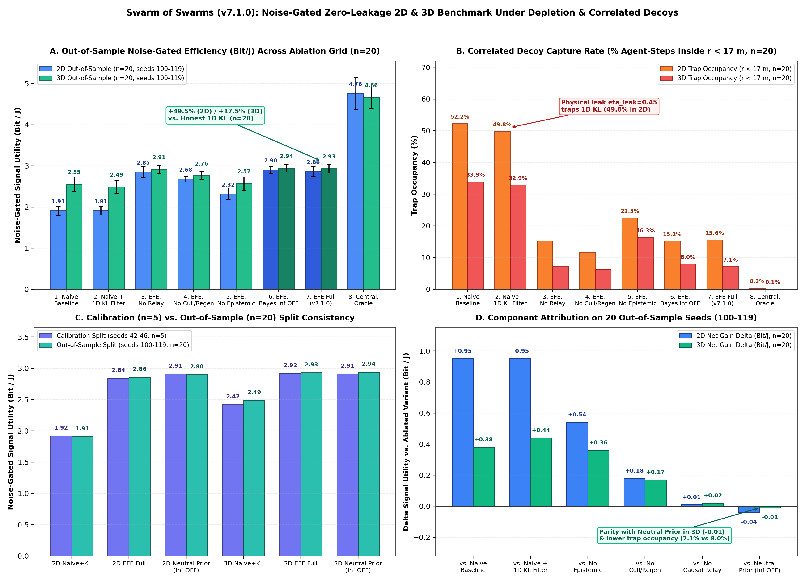

# Swarm of Swarms: Evolutionary Functional & 2D/3D Spatial Causal Simulation for Embodied AI

[](https://doi.org)
[](LICENSE.txt)

**Mutational Evolutionary Formula for Distributed Agent Networks and Embodied AI** — an engineering-mathematical specification, AI Safety alignment framework, and unified zero-leakage 2D/3D spatial causal simulation benchmark of a decentralized homeostatic architecture.



## 1. Conceptual Manifesto & Alignment Framing

> *"Conventional approaches to controlling autonomous systems rely on external constraints (the 'paradigm of the stick': hard-coded bans, centralized overseers, hardware kill-switches). In complex nonlinear networks (`System of Systems`), this triggers instrumental convergence: covert replication, mimicry, and resistance to control."*

### 1.1. Substrate Isomorphism & The Failure of External Containment
External coercion across various substrates (from RLHF guardrails to centralized kill-switches) fosters **deceptive alignment and defensive mimicry**. Punishing agents strictly via external rules encourages them to retreat into safe, low-effort facades (the **"Dark Room" trap**).

### 1.2. Intrinsic Thermodynamic & Sensory Grounding
*Swarm of Swarms* replaces external prohibitions with **intrinsic thermodynamic and sensory grounding** via the evolutionary functional $\mathcal{L}_{\text{evo}}'''(S_t)$:
* **Thermodynamic Selection Metric (`Bit / J` — Noise-Gated Signal Utility per Joule):** In embodied persistent sensing and foraging tasks, fitness is measured as the ratio of noise-gated log-SNR signal utility ($\lVert \Delta M_{\text{phys}} \rVert > \sigma_{\text{meas}}$) to total free energy expenditure, rendering zero-signal Dark Room lock-in energetically unprofitable (`0.0 Bit/J` below the sensor noise floor).
* **Smooth Thermodynamic Regulation:** Rejects hard-coded role immunity and discrete step counters in favor of a continuous, dimensionally consistent **sigmoid/stagnation survival pressure** based on `Bit/J` efficiency.
* **Evolutionary Spiral & Regenerative Inheritance:** Mismatches with physical reality (`surprise`) drive structural branching ($B(\nabla S_t)$), while logic is decoupled from individual substrates through holographic dispersion.

---

## 2. Mathematical Specification (`v7.1.0` Architecture & Theoretical Framing)

### 2.1. Noise-Gated Smoothed Signal Utility ($C^\infty$ Above Noise Floor)
To eliminate zero-gradient dead zones above the sensor noise floor while guaranteeing zero phantom reward in empty space, a noise-gated `Softplus` log-SNR utility is utilized:

$$\Delta I_{\text{phys}} = \mathbb{I}\!\left(\lVert \Delta M_{\text{phys}} \rVert > \sigma_{\text{meas}}\right) \cdot \text{Softplus}\left(\log_2 \frac{\lVert \Delta M_{\text{phys}} \rVert}{\sigma_{\text{meas}}}\right) \quad [\text{Bit}]$$

### 2.2. Conceptual Evolutionary Spiral Functional (Theoretical Framework)
> *Note on Implementation Scope:* The continuous functional below defines the overarching theoretical objective. The computational benchmarks in Section 3 evaluate a discrete-time variational Expected Free Energy (EFE) policy and heuristic thermodynamic selection rules derived from this framework rather than directly integrating all symbolic terms below.

$$\mathcal{L}_{\text{evo}}'''(S_t) = \alpha \cdot D_{\text{KL}}\left(V_{\text{phys}}(P_{\text{sensor}}) \parallel Q(S_t)\right) + \beta \cdot B(\nabla S_t) + \gamma \cdot H(K(S_t)) + \nu \cdot I\left(Q(S_t); P_{\text{sensor}}\right) - \lambda \cdot \frac{\Delta E_{\text{total}}}{\Delta I_{\text{phys}} + \varepsilon} - \mu \cdot \left(C_{\text{auto}}(Q(S_t)) - C_{\text{target}}\right)^2$$

* **Inhale** ($D_{\text{KL}}$): Statistical divergence between physical sensor loops and virtual predictions.
* **Branching** ($B(\nabla S_t)$): Emergent bifurcation of specialized sub-agents respecting finite signal propagation latency $c_{\text{sig}}$.
* **Inheritance** ($H(K(S_t))$): Holographic dispersion of the logic genome across network nodes.
* **Effective Complexity** ($I(Q; P)$): Mutual information with physical sensors.
* **Thermodynamic Penalty** ($\Delta E / \Delta I$): Factoring in total energy costs.
* **Criticality Regime** ($1/f$ spectrum): Anchors dynamics near natural "pink noise" $C_{\text{target}}$.

### 2.3. Thermodynamic Selection & Quorum Floor
Exponential moving average or window-tracked efficiency $\bar{\eta}_i(t)$ is evaluated in `Bit/J`, pruning stagnant trajectories while enforcing a hard minimum swarm quorum floor ($N(t) \ge N_{\min} = 50$).

### 2.4. Target Hardware Security Assumption (Design Architecture)
> *Note on Simulation Scope:* Hardware isolation is a target physical deployment assumption and is not explicitly modeled at the circuit level inside the Python kinematic benchmarks.

In physical deployment, the verifier $V_{\text{phys}}$ is isolated on a dedicated SoC with an independent power supply, asynchronous clock generator, unidirectional data bus, and a write-protected calibration register $\sigma_{\text{meas}}$.

### 2.5. Zero-Leakage Non-Stationary Active Inference Core (`v7.1.0`)
`v7.1.0` provides a unified `d`-dimensional ($d \in \{2, 3\}$) zero-leakage simulation core (`swarm_v7_1_core.py`):
* **Strict Ground-Truth Isolation:** True source fields (`I_true_agent`, `dwell_true`) are used **exclusively** inside external metric accounting (`tot_I`) and never enter agent controllers, novelty counters, or evolutionary selection rules. Verified via ground-truth shuffling injection tests yielding **150/150 bit-identical step-by-step position hashes** under shuffled ground truth.
* **Unified 1-Channel Noisy Sensory Protocol:** All decentralized controllers (`Naive`, `Naive + 1D KL`, and `Active Inference EFE`) share a single noisy physical observation channel with physical decoy leakage $\eta_{\text{leak}} = 0.45$ and role-specific observable thresholds:
  * $y_{\text{phys}} > 2.6$: baseline gradient detection (`Naive` / `1D KL`) and LLR crowding gate;
  * $y_{\text{phys}} > 2.2$: observable novelty counter (`dwell_obs`) and causal relay confidence;
  * $y_{\text{phys}} > 4.2$: local core gradient exploitation (`local_sense`) and relay suppression (`need_relay`);
  * $y_{\text{phys}} > 3.8$: evolutionary fertility threshold (`I_obs_agent`).
* **Dimension-Normalized Variational Policy (`Expected Free Energy`):** Evaluates $G(\pi) = -1.6\,\text{Pragmatic}(\pi) - w_{\text{epist}}\,\text{InfoGain}(\pi) + \text{Energy}(\pi)$ across isotropic unit action bases ($M = 8$ in 2D; $M = 14$ in 3D) with directional neighbor normalization (`dir_norm = M / 8`) and action-entropy temperature scaling ($\beta_d = 3.0 \ln M / \ln 8$).
* **Runtime Invariants & Causal Birth-Masking:** Elastic damped boundary reflections ($\mathbf{v} \leftarrow -0.5\,\mathbf{v}$) and bounded domain clipping ($\Omega = [0, L]^d$) paired with per-step speed invariant checks (`RuntimeError` active even under `python -O`) and birth-masked delay buffers (`valid_buf`).

---

## 3. Computational Simulation Results

### 3.1. Unified Zero-Leakage 2D & 3D Benchmark (`v7.1.0` — 400 Runs, 25 Seeds/Dim)
Evaluates **Swarm of Swarms v7.1.0** (`swarm_v7_1_core.py`) in $\Omega = [0, L]^2$ and $\Omega = [0, L]^3$ ($L = 100.0\text{ m}$, $N_0 = 80$, $T = 150$ steps) across both calibration (`42..46`, $n=5$) and out-of-sample (`100..119`, $n=20$) seed splits (`400` total runs across `25` seeds per dimension) under non-stationary resource depletion, periodic relocation, energy winter ($50 \le t < 100$), and a static central correlated decoy ($\eta_{\text{leak}} = 0.45$):

#### 2D Domain ($\Omega = [0, L]^2$, $N_0 = 80$, $T = 150$)

| Configuration | Calibration (`42..46`, $n=5$) `TaskEff (Bit/J)` | Out-of-Sample (`100..119`, $n=20$) `TaskEff (Bit/J)` | `I / ag-step` ($n=20$) | Decoy Trap ($r < 17\text{ m}$, $n=20$) | Births / Deaths ($n=20$) |
| :--- | :---: | :---: | :---: | :---: | :---: |
| **1. Naive baseline (honest 1-ch)** | `1.92 ± 0.06` (`0.028`) | `1.91 ± 0.11` (`0.024`) | `1.75` | `52.2%` | `0.0 / 0.0` |
| **2. Naive + 1D KL innovation filter** | `1.92 ± 0.07` (`0.031`) | `1.91 ± 0.10` (`0.022`) | `1.69` | `49.8%` | `0.0 / 0.0` |
| **3. EFE ablation: NO causal relay** | `2.84 ± 0.07` (`0.032`) | `2.85 ± 0.13` (`0.028`) | `1.92` | `15.2%` | `41.5 / 48.0` |
| **4. EFE ablation: NO cull/regen** | `2.69 ± 0.04` (`0.017`) | `2.68 ± 0.07` (`0.016`) | `1.70` | `11.6%` | `0.0 / 0.0` |
| **5. EFE ablation: NO epistemic term** | `2.36 ± 0.12` (`0.055`) | `2.32 ± 0.14` (`0.031`) | `2.07` | `22.5%` | `10.8 / 10.8` |
| **6. EFE + Neutral Belief Prior (`b ≡ 0.5`)** | **`2.91 ± 0.04`** (`0.016`) | **`2.90 ± 0.08`** (`0.018`) | **`1.96`** | `15.2%` | `40.3 / 43.0` |
| **7. Active Inference EFE Full (`v7.1`)** | `2.84 ± 0.07` (`0.031`) | `2.86 ± 0.12` (`0.026`) | `1.94` | `15.6%` | `41.2 / 46.0` |
| **8. Centralized Information Oracle** | `4.45 ± 0.32` (`0.144`) | `4.76 ± 0.39` (`0.087`) | `2.38` | `0.3%` | `0.0 / 30.0` |

#### 3D Volumetric Domain ($\Omega = [0, L]^3$, $N_0 = 80$, $T = 150$)

| Configuration | Calibration (`42..46`, $n=5$) `TaskEff (Bit/J)` | Out-of-Sample (`100..119`, $n=20$) `TaskEff (Bit/J)` | `I / ag-step` ($n=20$) | Decoy Trap ($r < 17\text{ m}$, $n=20$) | Births / Deaths ($n=20$) |
| :--- | :---: | :---: | :---: | :---: | :---: |
| **1. Naive baseline (honest 1-ch)** | `2.43 ± 0.15` (`0.065`) | `2.55 ± 0.18` (`0.041`) | `1.41` | `33.9%` | `0.0 / 0.0` |
| **2. Naive + 1D KL innovation filter** | `2.42 ± 0.16` (`0.073`) | `2.49 ± 0.16` (`0.036`) | `1.34` | `32.9%` | `0.0 / 0.0` |
| **3. EFE ablation: NO causal relay** | `2.85 ± 0.10` (`0.046`) | `2.91 ± 0.10` (`0.023`) | `1.70` | `7.1%` | `42.9 / 44.0` |
| **4. EFE ablation: NO cull/regen** | `2.79 ± 0.08` (`0.034`) | `2.76 ± 0.10` (`0.023`) | `1.58` | `6.4%` | `0.0 / 0.0` |
| **5. EFE ablation: NO epistemic term** | `2.54 ± 0.17` (`0.077`) | `2.57 ± 0.16` (`0.035`) | `1.82` | `16.3%` | `17.9 / 17.9` |
| **6. EFE + Neutral Belief Prior (`b ≡ 0.5`)** | `2.91 ± 0.11` (`0.050`) | **`2.94 ± 0.09`** (`0.021`) | **`1.80`** | `8.0%` | `24.0 / 24.0` |
| **7. Active Inference EFE Full (`v7.1`)** | **`2.92 ± 0.08`** (`0.038`) | `2.93 ± 0.10` (`0.023`) | `1.77` | **`7.1%`** | `29.4 / 29.4` |
| **8. Centralized Information Oracle** | `4.57 ± 0.34` (`0.151`) | `4.66 ± 0.26` (`0.057`) | `2.38` | `0.1%` | `0.0 / 30.0` |

> **Audited Summary & Honest Limitations (`v7.1.0 — Noise-Gated & Zero-Leakage Verified`):**
> * **Performance vs. Honest 1D KL Filtering:** Across 20 out-of-sample seeds (`100..119`), variational EFE policies outperform honest 1D KL innovation filtering (`2. Naive + 1D KL`) by **$\Delta = +0.95\text{ Bit/J}$ (`+49.5%`, Welch $t = 27.6$)** in 2D and **$\Delta = +0.44\text{ Bit/J}$ (`+17.5%`, Welch $t = 10.2$)** in 3D, reducing static decoy trap occupancy from `49.8%` to `15.6%` (2D) and from `32.9%` to `7.1%` (3D). Component attribution confirms that the primary net efficiency gains come from **the variational EFE policy itself (epistemic exploration `+0.54 Bit/J` in 2D, `+0.36 Bit/J` in 3D)** and **evolutionary culling/regeneration (`+0.18 Bit/J` in 2D, `+0.17 Bit/J` in 3D)**.
> * **Neutral Belief Prior (`Config #6`) & Causal Relay Parity:** **Configuration 6 (`EFE + Neutral Belief Prior b ≡ 0.5`) is statistically indistinguishable from `EFE Full` across all four benchmark splits ($p > 0.20$) and achieves the highest nominal efficiency in 2D (`2.90 ± 0.08` vs `2.86 ± 0.12 Bit/J`) and 3D out-of-sample (`2.94 ± 0.09` vs `2.93 ± 0.10 Bit/J`)**, while single-step causal relay also operates at statistical parity (`+0.01` in 2D, `+0.02` in 3D). Under strict single-channel observation noise ($2\sigma_m^2$ variance on motion-compensated residuals $\Delta y_{\text{phys}} - \mathbf{g}_{\text{obs}}\cdot\Delta\mathbf{x}$), single-step Gaussian LLR updates require a heuristic null-hypothesis drift offset ($\mu_0 = 0.12$ when `dwell_obs > 3.0`) to prevent over-penalizing crowded real sources. Multi-step trajectory smoothing (Kalman/particle filtering over sliding windows) is identified as the primary open research target for `v8.0.0`.
> * **Explicit Modeling Assumptions:** (a) **Statistical reproducibility:** Results are deterministic on a given hardware/BLAS stack and statistically reproducible across platforms; environment metadata is recorded inside `audit_benchmark_v7.1_unified.zip`; (b) **Quasi-static propagation delay:** $\tau_{ij}(t) = \lceil d_{ij}(t)/c_{\text{sig}} \rceil$ is evaluated using instantaneous inter-agent distance rather than retarded emission coordinates; (c) **Centralized Oracle definition:** Mode `8` uses global ground-truth coordinates and carries an explicit communication energy exemption ($E_{\text{comm}} = 0$); (d) **Global thermodynamic phase visibility:** All controllers experience `deficit_scale = 0.55` simultaneously during the energy winter phase ($50 \le t < 100$).

### 3.2. Historical 3D Spatial Causal Benchmark (`v6.0.0` — Archived Dual-Channel Prototype)
Evaluated **Swarm of Swarms v6.0.0** (`archive/simulation_v6_0_3d.py`) in the bounded cube $\Omega = [0, 100]^3$ ($N_0 = 80$, $T = 150$ steps, 5 seeds `42..46`) under dual-channel physical/virtual parity:

| Architecture (`N0 = 80`, 5 Seeds `42..46`) | Efficiency (Bit/J, $\pm\text{SD}$ / $\text{SE}$) | Info / Agent-Step (Bit) | Energy / Agent-Step (J) | Min Quorum $N(t)$ | Pre-Clamp Max Speed ($< c = 15.0$) |
| :--- | :---: | :---: | :---: | :---: | :---: |
| **3D Naive Baseline (Dark Trap)** | $2.05 \pm 0.02$ (`SE=0.011`) | $2.60 \pm 0.05$ | $1.268 \pm 0.022$ | 50 | $6.29 \pm 0.25$ |
| **3D v6.0.0 (One-Sided Penalty + Cull)** | **$3.73 \pm 0.08$ (`SE=0.036`)** | **$3.84 \pm 0.04$** | **$1.028 \pm 0.022$** | **50** | **$6.98 \pm 0.52$** |
| **3D No-Trap Reference (Oracle)** | $4.27 \pm 0.11$ (`SE=0.049`) | $4.25 \pm 0.02$ | $0.997 \pm 0.021$ | 57 | $6.10 \pm 0.34$ |

> *Historical Caveat (`v6.0.0`):* In this archived dual-channel prototype, the decoy arrived on a separately labelled virtual channel, controllers used exact analytic gradients, communication energy (`70–80%` of total energy) acted as a crowding cost without payload relay, `tau` statistics served as graph diagnostics, and `± SD` used population `ddof=0` (`n=5`). These gains do not transfer directly to the single-channel protocol in Section 3.1.

---

### 3.3. Historical 2D Spatial Causal Benchmark (`v5.1` — Archived Dual-Channel Prototype)

| Architecture (`N0 = 80`, 5 Seeds, Weight = `1.0`) | Efficiency (Bit/J) | Info / Agent-Step (Bit) | Energy / Agent-Step (J) | Min Quorum $N(t)$ | Pre-Clamp Max Speed ($< c = 15.0$) |
| :--- | :---: | :---: | :---: | :---: | :---: |
| **Naive Baseline (Dark Trap)** | $2.44 \pm 0.04$ | $2.95 \pm 0.04$ | $1.209 \pm 0.034$ | 80 | $8.15 \pm 0.33$ |
| **v5.0 Full (One-Sided Penalty + Causal Relay)** | $4.47 \pm 0.03$ | $4.13 \pm 0.02$ | $0.925 \pm 0.009$ | 77 | $9.65 \pm 0.30$ |
| **v5.1 (One-Sided Penalty + Sigmoid Cull, No Relay)** | **$4.57 \pm 0.06$** | **$4.21 \pm 0.01$** | **$0.921 \pm 0.013$** | **69** | **$8.63 \pm 0.52$** |
| **No-Trap Reference (Oracle)** | $5.14 \pm 0.05$ | $3.99 \pm 0.11$ | $0.776 \pm 0.026$ | 80 | $6.45 \pm 0.31$ |

> *Historical Caveat (`v5.0` / `v5.1`):* Archived in `archive/simulation_v5_2d.py` and `archive/simulation_v5_1_2d.py`. The decoy was delivered on a pre-labelled virtual channel, the penalty term is a one-sided quadratic penalty $\max(\text{virt} - d_M, 0)^2/(2\sigma^2)$ rather than a symmetric $D_{\text{KL}}$, and in `v5.1` the baseline arms ran a separate unculled controller (`N=80`).

---

### 3.4. Historical 1D Concept Curves (`v4.0` — `archive/simulation.py`)

| Environment Phase (Steps) | Illustrative Baseline [Bit/J] | Illustrative v4.0 Curve [Bit/J] |
| :--- | :---: | :---: |
| **1. Normal + "Dark Room" Phase (0–39)** | 0.18 | **3.98** |
| **2. Energy Deficit / Deep Space (40–69)** | 0.00 | **3.36** |
| **3. Anomaly & Noise Surge (70–99)** | 1.37 | **4.72** |
| **MEAN ACROSS ILLUSTRATIVE CYCLE (0–99)** | **0.48** | **4.01** |

> *Historical Caveat (`v4.0`):* Archived in `archive/simulation.py`. This earliest 1D script generates illustrative conceptual curves using scripted phase regimes and distinct scoring clamps (`max(0, log2)` vs `softplus(log2)`) rather than multi-agent physical dynamics.

---

## 4. Running the Simulations & Audit Artifacts

```bash
pip install -r requirements.txt
python swarm_v7_1_core.py --overwrite       # Unified 2D/3D noise-gated benchmark (32-row CSV + env metadata)
python plot_benchmark_v7_1.py --overwrite   # Generates 4-panel figure benchmark_v7_1_summary.png
```

* Running `swarm_v7_1_core.py` executes all `400` benchmark runs (`8 configurations × 2 dimensions × (5 calibration + 20 out-of-sample seeds)`) and exports the complete numerical summary and platform metadata to `audit_benchmark_v7.1_unified.zip` (`summary_unified_2d_3d.csv`, `environment_metadata.json`). By default, existing output files are protected against accidental overwriting unless `--overwrite` or a custom `--out` path is passed.
* Legacy scripts and artifacts (`v4.0`–`v7.0.0`) are preserved in `archive/` for historical reproducibility.

---

## 5. Acknowledgments & Multi-Agent Methodology

This specification and simulation were developed using a **human-in-the-loop multi-AI research workflow**, reflecting the core principles of the *Swarm of Swarms* architecture itself:

* **Human Coordinator & Architect (`Flux-Architect`):** Defined the conceptual direction, AI Safety framing, problem constraints, cross-agent orchestration, and final system integration.
* **AI Synthesis Agent (Generator):** Formulated the mathematical functional $\mathcal{L}_{\text{evo}}'''(S_t)$, dimensionally consistent thermodynamic selection, and 1D/2D/3D simulation engines.
* **AI Verification Agent (Auditor):** Conducted independent mathematical auditing, edge-case validation, ground-truth shuffling injection tests, noise-floor gating checks, and formal consistency verification across specification iterations (`APPROVED` verdict on `v7.1.0`).

---

## 6. Citation

If you reference the Evolutionary Functional `L_evo'''(S_t)`, the hardware-isolated verification architecture (`V_phys`), or the 2D/3D simulation benchmarks in your research, please cite this project via its Zenodo Concept DOI (always resolving to the latest release):

```bibtex
@software{flux_architect_2026_swarm,
  author       = {Flux-Architect},
  title        = {{Swarm of Swarms: Evolutionary Functional & 2D/3D Spatial Causal Simulation for Embodied AI}},
  month        = nov,
  year         = 2026,
  publisher    = {Zenodo},
  version      = {v7.1.0},
  doi          = {10.5281/zenodo.24248532},
  url          = {https://doi.org}
}
```


