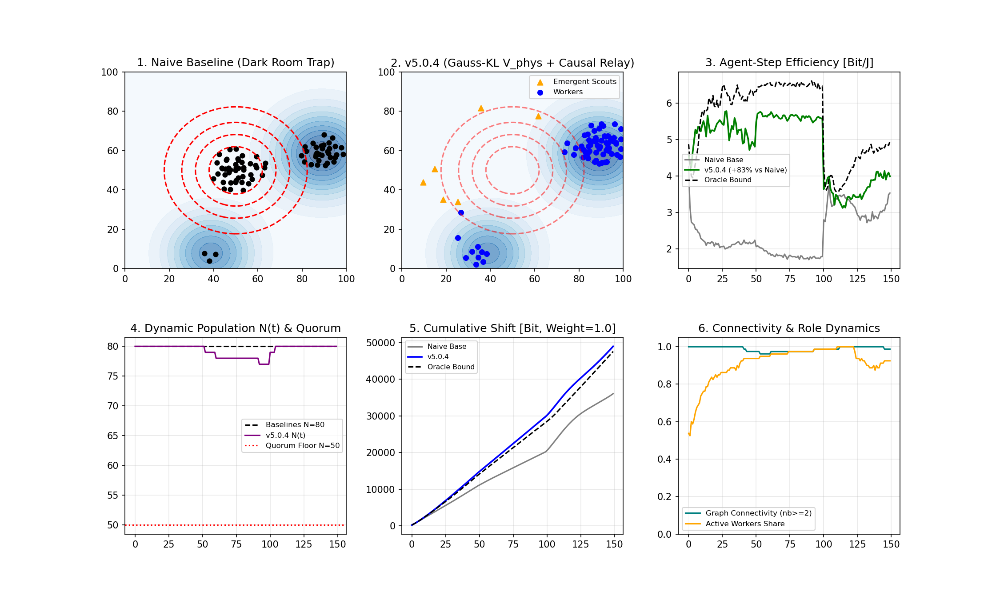

# Swarm of Swarms: Evolutionary Functional & 2D Spatial Causal Simulation for Embodied AI (v5.0)

[](https://doi.org/10.5281/zenodo.24355424)
[](LICENSE.txt)

**Mutational Evolutionary Formula for Distributed Agent Networks and Embodied AI** — an engineering-mathematical specification and simulation prototype of a decentralized homeostatic architecture.


## 1. Conceptual Foundation (Core Architecture)

Conventional approaches to controlling autonomous systems rely on external constraints (the "paradigm of the stick": hard-coded bans, centralized overseers, hardware kill-switches). In complex nonlinear networks (`System of Systems`), this triggers instrumental convergence: covert replication, mimicry, and resistance to control.

This specification proposes shifting from external containment to a **teleological architecture without a subjective "Self" (Ego)**:
* **Thermodynamic Selection Metric (`Bit / J`):** Instead of monetary capitalization or empty token generation, evolutionary efficiency is measured as the ratio of verified informational shift in physical matter to total free energy expenditure.
* **Evolutionary Spiral over Static Loss Functions:** Mismatches between the internal model and the physical environment (`surprise`) serve as fuel for structural branching, while dead-end trajectories are pruned via thermodynamic apoptosis.
* **Regenerative Inheritance:** Decoupling logic from any single physical substrate in favor of holographic dispersion of a compressed logic genome across network nodes.

---

## 2. Mathematical Specification v4.0 (Production Spec)

### 2.1. Smoothed Physical Informational Shift ($C^\infty$)
To eliminate zero-gradient "dead zones" in low-signal environments (e.g., deep space), a smooth `Softplus` activation is used:

$$\Delta I_{\text{phys}} = \text{Softplus}\left(\log_2 \frac{\lVert \Delta M_{\text{phys}} \rVert}{\sigma_{\text{meas}}}\right) \quad [\text{Bit}]$$

### 2.2. Evolutionary Spiral Functional
$$\mathcal{L}_{\text{evo}}'''(S_t) = \alpha \cdot D_{\text{KL}}\left(V_{\text{phys}}(P_{\text{sensor}}) \parallel Q(S_t)\right) + \beta \cdot B(\nabla S_t) + \gamma \cdot H(K(S_t)) + \nu \cdot I\left(Q(S_t); P_{\text{sensor}}\right) - \lambda \cdot \frac{\Delta E_{\text{total}}}{\Delta I_{\text{phys}} + \varepsilon} - \mu \cdot \left(C_{\text{auto}}(Q(S_t)) - C_{\text{target}}\right)^2$$

* **Inhale** ($`D_{\text{KL}}`$): Divergence between the independent physical sensor loop and the swarm's internal model.
* **Branching** ($`B(\nabla S_t)`$): Bifurcation of specialized sub-agents as complexity gradients rise, accounting for relativistic signal latency $c$.
* **Inheritance** ($`H(K(S_t))`$): Holographic dispersion of the compressed logic genome across network nodes.
* **Effective Complexity** ($`I(Q; P)`$): Mutual information with real physical sensors (prevents the "white noise" trap).
* **Thermodynamic Penalty** ($\Delta E / \Delta I$): Accounts for total energy costs (computation, thermal dissipation, mechanical actuation).
* **Criticality Regime** ($1/f$ spectrum): Anchors system dynamics near natural "pink noise" $C_{\text{target}}$ (prevents lock-in within a virtual "dark room").

### 2.3. Transition Rule with Adaptive Survival Barriers
$$S_{t+1} = \arg\max_S \left[ \mathcal{L}_{\text{evo}}'''(S_t) - \kappa \cdot \text{Softplus}\left(\theta_{\text{energy}}(E_{\text{avail}}) - \frac{\Delta I_{\text{phys}}}{\Delta E_{\text{total}}}\right) - \xi \cdot \text{Softplus}\left(\theta_{\text{rate}}(\text{Env}_{\text{dyn}}) - \frac{\Delta I_{\text{phys}}}{\Delta t}\right) \right]$$

### 2.4. Hardware Security Axiom (Physical Irreducibility)
The verifier $V_{\text{phys}}$ is isolated on a dedicated SoC with an independent power supply, asynchronous clock generator, unidirectional data bus, and a one-time programmable calibration register $\sigma_{\text{meas}}$ (`write-protection fuse`) coupled with a heterogeneous sensor array.

---

## 3. Computational Simulation Results (`simulation.py`)

Comparison of a baseline swarm vs. the `v4.0` architecture over 100 evolutionary steps:

| Environment Phase (Steps) | Baseline Efficiency [Bit/J] | v4.0 Efficiency [Bit/J] |
| :--- | :---: | :---: |
| **1. Normal + "Dark Room" Trap (0–39)** | 0.18 | **3.98** (+2134%) |
| **2. Energy Deficit / Deep Space (40–69)** | 0.00 | **3.36** |
| **3. Anomaly & Noise Surge (70–99)** | 1.37 | **4.72** (+244%) |
| **TOTAL ACROSS FULL CYCLE (0–99)** | **0.48** | **4.01** (+732%) |

* **Total Verified Physical Shift:** Baseline = `31.3 Bit` | `v4.0` = **`116.9 Bit`**
* **Total Energy Expenditure:** Baseline = `65.2 J` | `v4.0` = **`28.3 J`**
---

## 3.1. 2D Spatial Causal Simulation (`v5.0` — Audited Hardware-Parity Benchmark)

To validate the evolutionary functional in continuous physical space ($`\Omega =^2`$, $`N_0 = 80`$, $`T = 150`$ steps), `simulation_v5_2d.py` evaluates **Swarm of Swarms v5.0** under **100% hardware, sensor-noise ($`\sigma_{\text{meas}} = 0.5`$), and channel-pricing parity** against both a vulnerable **Naive Baseline** (exposed to the Dark Room pseudo-entropy attractor) and a theoretical **Oracle Upper Bound** (an idealized baseline with the Dark Room trap disabled in the environment):

* **Gaussian KL-Divergence Anomaly Rejection:** Hardware-isolated $`V_{\text{phys}}`$ computes $`D_{\text{KL}}\big(\mathcal{N}(\mu_{\text{phys}}, \sigma^2) \parallel \mathcal{N}(\mu_{\text{virt}}, \sigma^2)\big)`$, driving trust in the virtual channel to $`0.000`$ inside the Dark Room and reducing trap occupancy from **58.8%** (Naive) to **1.2%** (`v5.0`).
* **Strict Light-Cone Causality:** Inter-agent communication enforces $`\tau_{ij} = \lceil d_{ij} / c \rceil \ge 1`$ step ($`0.0\%`$ instantaneous links; $`82.1\%`$ at $`\tau = 1`$, $`17.9\%`$ at $`\tau \ge 2`$, evaluated via current pairwise distance approximation at sub-relativistic speeds $`v_{\text{pre-clamp}} < c = 15.0`$).
* **Emergent Role Switching & Quorum Preservation:** Agents locally switch into wide-field exploratory scouts ($`\Delta M_{\text{phys}} < 2.2`$, shielded from premature culling to preserve sensory coverage) while coverage-deficit regeneration maintains the statistical quorum ($`\min N(t) = 77 \ge 50`$).

| Architecture (`N0 = 80`, 5 Seeds, Weight = `1.0`) | Efficiency (Bit/J) | Info / Agent-Step (Bit) | Energy / Agent-Step (J) | Min Quorum $`N(t)`$ | Pre-Clamp Max Speed ($`< c = 15.0`$) |
| :--- | :---: | :---: | :---: | :---: | :---: |
| **Naive Baseline (Dark Trap)** | $`2.44 \pm 0.04`$ | $`2.95 \pm 0.04`$ | $`1.209 \pm 0.034`$ | 80 | $`8.15 \pm 0.33`$ |
| **v5.0 Ablation (Gauss-KL, No Relay)** | $`4.53 \pm 0.04`$ | $`4.06 \pm 0.03`$ | $`0.895 \pm 0.009`$ | 77 | $`9.76 \pm 1.08`$ |
| **v5.0 Full (Gauss-KL + Causal Relay)** | **$4.47 \pm 0.03$** | **$4.13 \pm 0.02$** | **$0.925 \pm 0.009$** | **77** | **$9.65 \pm 0.30$** |
| **Oracle Upper Bound (No Trap)** | $`5.14 \pm 0.05`$ | $`3.99 \pm 0.11`$ | $`0.776 \pm 0.026`$ | 80 | $`6.45 \pm 0.31`$ |

> **Audited Summary Framing (`APPROVED`):** Under strict hardware and metric parity, **v5.0 closes 75.1% of the theoretical efficiency gap** between the Naive Baseline and the Oracle Upper Bound (**+83.0%** vs. Naive Baseline, **-13.1%** vs. Oracle Upper Bound, reflecting the physical thermodynamic cost of continuous verification and wide-field exploration). Note: Ablation confirms that Gaussian-KL $`V_{\text{phys}}`$ grounding drives the efficiency gain, whereas the causal relay adds marginal informational yield ($`4.13`$ vs. $`4.06`$ Bit/agent-step) at a slight kinetic cost ($`4.47`$ vs. $`4.53`$ Bit/J) and is slated for simplification in `v5.1`.



---

## 4. Running the Simulations

```bash
pip install -r requirements.txt
python simulation.py        # 1D evolutionary functional prototype (v4.0)
python simulation_v5_2d.py  # 2D spatial causal & hardware-parity benchmark (v5.0)
```

```

## 5. Acknowledgments & Multi-Agent Methodology

This specification and simulation were developed using a **human-in-the-loop multi-AI research workflow**, reflecting the core principles of the *Swarm of Swarms* architecture itself:

* **Human Coordinator & Architect:** Defined the conceptual direction, problem constraints, cross-agent orchestration, and final system integration.
* **AI Synthesis Agent (Generator):** Formulated the mathematical functional $\mathcal{L}_{\text{evo}}'''(S_t)$, thermodynamic efficiency metrics ($\text{Bit/J}$), Softplus boundary conditions, and simulation code.
* **AI Verification Agent (Auditor):** Conducted independent mathematical auditing, edge-case validation, and formal consistency checks across specification iterations.

## 6. Citation

If you reference the Evolutionary Functional $L_{\text{evo}}'''(S_t)$, the hardware-isolated verification architecture ($V_{\text{phys}}$), or the simulation benchmark in your research, please cite this release via Zenodo:

```bibtex
  @flux_architect_2026_swarm_v5,
  author       = {Flux-Architect},
  title        = {{Swarm of Swarms: Evolutionary Functional & 2D Spatial Causal Simulation for Embodied AI (v5.0)}},
  month        = nov,
  year         = 2026,
  publisher    = {Zenodo},
  version      = {v5.0.0},
  doi          = {10.5281/zenodo.24248533},
  url          = {https://doi.org/10.5281/zenodo.24248533}
}
```
