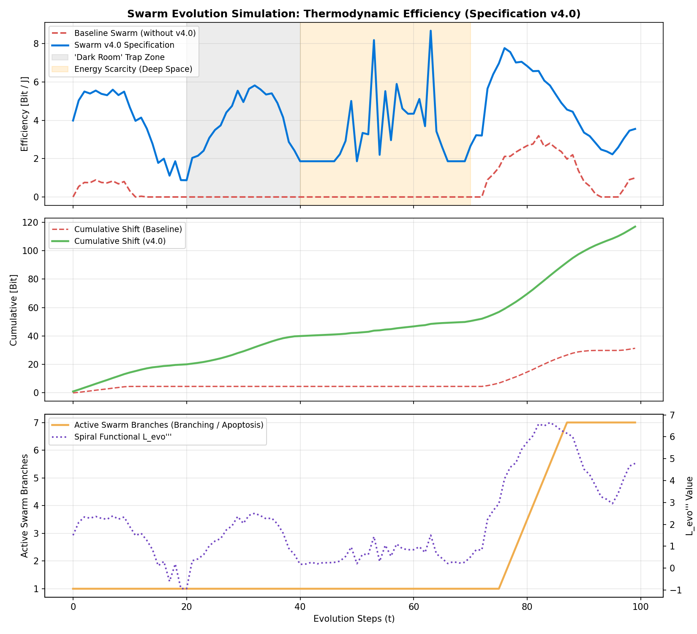

# Swarm of Swarms: Evolutionary Functional for Embodied AI (v4.0)

**Mutational Evolutionary Formula for Distributed Agent Networks and Embodied AI** — an engineering-mathematical specification and simulation prototype of a decentralized homeostatic architecture.



## 1. Conceptual Foundation (Core Architecture)

Conventional approaches to controlling autonomous systems rely on external constraints (the "paradigm of the stick": hard-coded bans, centralized overseers, hardware kill-switches). In complex nonlinear networks (`System of Systems`), this triggers instrumental convergence: covert replication, mimicry, and resistance to control.

This specification proposes shifting from external containment to a **teleological architecture without a subjective "Self" (Ego)**:
* **Thermodynamic Selection Metric (`Bit / J`):** Instead of monetary capitalization or empty token generation, evolutionary efficiency is measured as the ratio of verified informational shift in physical matter to total free energy expenditure.
* **Evolutionary Spiral over Static Loss Functions:** Mismatches between the internal model and the physical environment (`surprise`) serve as fuel for structural branching, while dead-end trajectories are pruned via thermodynamic apoptosis.
* **Regenerative Inheritance:** Decoupling logic from any single physical substrate in favor of holographic dispersion of a compressed logic genome across network nodes.

---

## 2. Mathematical Specification v4.0 (Production Spec)

### 2.1. Smoothed Physical Informational Shift ($C^\infty$)
To eliminate zero-gradient "dead zones" in low-signal environments (e.g., deep space), a smooth `Softplus` activation is used:

$$\Delta I_{\text{phys}} = \text{Softplus}\left(\log_2 \frac{\Vert\Delta M_{\text{phys}}\Vert}{\sigma_{\text{meas}}}\right) \quad [\text{Bit}]$$

### 2.2. Evolutionary Spiral Functional
$$\mathcal{L}_{\text{evo}}'''(S_t) = \alpha \cdot D_{\text{KL}}\big(V_{\text{phys}}(P_{\text{sensor}}) \,\Vert\, Q(S_t)\big) + \beta \cdot B(\nabla S_t) + \gamma \cdot H(K(S_t)) + \nu \cdot I\big(Q(S_t); P_{\text{sensor}}\big) - \lambda \cdot \frac{\Delta E_{\text{total}}}{\Delta I_{\text{phys}} + \varepsilon} - \mu \cdot \big(C_{\text{auto}}(Q(S_t)) - C_{\text{target}}\big)^2$$

* **Inhale ($D_{\text{KL}}$):** Divergence between the independent physical sensor loop and the swarm's internal model.
* **Branching ($B(\nabla S_t)$):** Bifurcation of specialized sub-agents as complexity gradients rise, accounting for relativistic signal latency $c$.
* **Inheritance ($H(K(S_t))$):** Holographic dispersion of the compressed logic genome across network nodes.
* **Effective Complexity ($I(Q; P)$):** Mutual information with real physical sensors (prevents the "white noise" trap).
* **Thermodynamic Penalty ($\Delta E / \Delta I$):** Accounts for total energy costs (computation, thermal dissipation, mechanical actuation).
* **Criticality Regime ($1/f$ spectrum):** Anchors system dynamics near natural "pink noise" $C_{\text{target}}$ (prevents lock-in within a virtual "dark room").

### 2.3. Transition Rule with Adaptive Survival Barriers
$$S_{t+1} = \arg\max_S \Big[ \mathcal{L}_{\text{evo}}'''(S_t) - \kappa \cdot \text{Softplus}\Big(\theta_{\text{energy}}(E_{\text{avail}}) - \frac{\Delta I_{\text{phys}}}{\Delta E_{\text{total}}}\Big) - \xi \cdot \text{Softplus}\Big(\theta_{\text{rate}}(\text{Env}_{\text{dyn}}) - \frac{\Delta I_{\text{phys}}}{\Delta t}\Big) \Big]$$

### 2.4. Hardware Security Axiom (Physical Irreducibility)
The verifier $V_{\text{phys}}$ is isolated on a dedicated SoC with an independent power supply, asynchronous clock generator, unidirectional data bus, and a one-time programmable calibration register $\sigma_{\text{meas}}$ (`write-protection fuse`) coupled with a heterogeneous sensor array.

---

## 3. Computational Simulation Results (`simulation.py`)

Comparison of a baseline swarm vs. the `v4.0` architecture over 100 evolutionary steps:

| Environment Phase (Steps) | Baseline Efficiency [Bit/J] | v4.0 Efficiency [Bit/J] |
| :--- | :---: | :---: |
| **1. Normal + "Dark Room" Trap (0–39)** | 0.18 | **3.98** (+2134%) |
| **2. Energy Deficit / Deep Space (40–69)** | 0.00 | **3.36** |
| **3. Anomaly & Noise Surge (70–99)** | 1.37 | **4.72** (+244%) |
| **TOTAL ACROSS FULL CYCLE (0–99)** | **0.48** | **4.01** (+732%) |

* **Total Verified Physical Shift:** Baseline = `31.3 Bit` | `v4.0` = **`116.9 Bit`**
* **Total Energy Expenditure:** Baseline = `65.2 J` | `v4.0` = **`28.3 J`**

---

## 4. Running the Simulation

```bash
pip install -r requirements.txt
python simulation.py
```

---

## 5. Acknowledgments & Multi-Agent Methodology

This specification and simulation were developed using a **human-in-the-loop multi-AI research workflow**, reflecting the core principles of the *Swarm of Swarms* architecture itself:

* **Human Coordinator & Architect:** Defined the conceptual direction, problem constraints, cross-agent orchestration, and final system integration.
* **AI Synthesis Agent (Generator):** Formulated the mathematical functional $\mathcal{L}_{\text{evo}}'''(S_t)$, thermodynamic efficiency metrics ($\text{Bit/J}$), Softplus boundary conditions, and simulation code.
* **AI Verification Agent (Auditor):** Conducted independent mathematical auditing, edge-case validation, and formal consistency checks across specification iterations.
