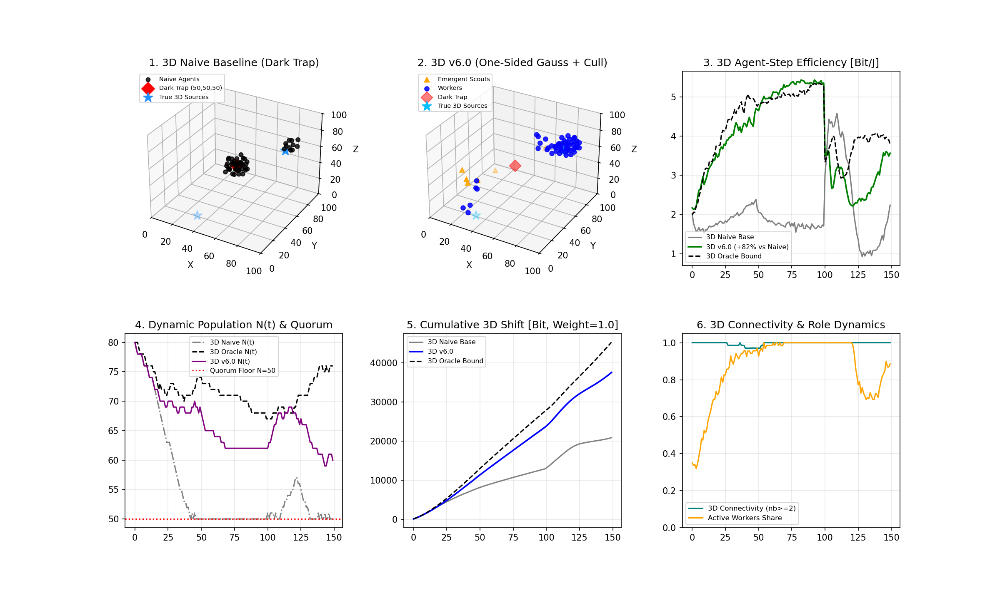

# Swarm of Swarms: Evolutionary Functional & 2D/3D Spatial Causal Simulation for Embodied AI

[](https://doi.org/10.5281/zenodo.24426908)
[](LICENSE.txt)

**Mutational Evolutionary Formula for Distributed Agent Networks and Embodied AI** — an engineering-mathematical specification, AI Safety alignment framework, and 2D/3D spatial causal simulation prototype of a decentralized homeostatic architecture.



## 1. Conceptual Manifesto & Alignment Framing

> *"Conventional approaches to controlling autonomous systems rely on external constraints (the 'paradigm of the stick': hard-coded bans, centralized overseers, hardware kill-switches). In complex nonlinear networks (`System of Systems`), this triggers instrumental convergence: covert replication, mimicry, and resistance to control."*

### 1.1. Substrate Isomorphism & The Failure of External Containment
External coercion across various substrates (from RLHF guardrails to centralized kill-switches) fosters **deceptive alignment and defensive mimicry**. Punishing agents strictly via external rules encourages them to retreat into safe, low-effort facades (the **"Dark Room" trap**).

### 1.2. Intrinsic Thermodynamic & Sensory Grounding
*Swarm of Swarms* replaces external prohibitions with **intrinsic thermodynamic and sensory grounding** via the evolutionary functional $\mathcal{L}_{\text{evo}}'''(S_t)$:
* **Thermodynamic Selection Metric (`Bit / J`):** Fitness is measured strictly as the ratio of verified informational shift in physical matter to total free energy expenditure, rendering hallucinations and Dark Room lock-in energetically unprofitable.
* **Smooth Thermodynamic Regulation:** Rejects hard-coded role immunity and discrete step counters in favor of a continuous, dimensionally consistent **sigmoid survival pressure** based on `Bit/J` efficiency.
* **Evolutionary Spiral & Regenerative Inheritance:** Mismatches with physical reality (`surprise`) drive structural branching ($B(\nabla S_t)$), while logic is decoupled from individual substrates through holographic dispersion.

---

## 2. Mathematical Specification (`v5.1` / `v6.0.0` Production Spec)

### 2.1. Smoothed Physical Informational Shift ($C^\infty$)
To eliminate zero-gradient dead zones, a smooth `Softplus` activation is utilized:

$$\Delta I_{\text{phys}} = \text{Softplus}\left(\log_2 \frac{\lVert \Delta M_{\text{phys}} \rVert}{\sigma_{\text{meas}}}\right) \quad [\text{Bit}]$$

### 2.2. Evolutionary Spiral Functional
$$\mathcal{L}_{\text{evo}}'''(S_t) = \alpha \cdot D_{\text{KL}}\left(V_{\text{phys}}(P_{\text{sensor}}) \parallel Q(S_t)\right) + \beta \cdot B(\nabla S_t) + \gamma \cdot H(K(S_t)) + \nu \cdot I\left(Q(S_t); P_{\text{sensor}}\right) - \lambda \cdot \frac{\Delta E_{\text{total}}}{\Delta I_{\text{phys}} + \varepsilon} - \mu \cdot \left(C_{\text{auto}}(Q(S_t)) - C_{\text{target}}\right)^2$$

* **Inhale** ($D_{\text{KL}}$): Statistical divergence between physical sensor loops and virtual predictions.
* **Branching** ($B(\nabla S_t)$): Emergent bifurcation of specialized sub-agents respecting relativistic signal latency $c$.
* **Inheritance** ($H(K(S_t))$): Holographic dispersion of the logic genome across network nodes.
* **Effective Complexity** ($I(Q; P)$): Mutual information with physical sensors.
* **Thermodynamic Penalty** ($\Delta E / \Delta I$): Factoring in total energy costs.
* **Criticality Regime** ($1/f$ spectrum): Anchors dynamics near natural "pink noise" $C_{\text{target}}$.

### 2.3. Smooth Sigmoid Thermodynamic Selection
Exponential moving average efficiency $\bar{\eta}_i(t)$ is evaluated in `Bit/J`, with selection pressure applied via a dimensionless thermodynamic sigmoid $P_{\text{cull}}(\bar{\eta}_i)$, ensuring smooth pruning of stagnant trajectories.

### 2.4. Hardware Security Axiom (Physical Irreducibility)
The verifier $V_{\text{phys}}$ is isolated on a dedicated SoC with an independent power supply, asynchronous clock generator, unidirectional data bus, and a write-protected calibration register $\sigma_{\text{meas}}$.

---

## 3. Computational Simulation Results

### 3.1. 3D Volumetric Spatial Causal Simulation (`v6.0.0` — Audited Hardware & Pipeline-Parity Benchmark)
Evaluates **Swarm of Swarms v6.0.0** in three-dimensional space ($\Omega = \mathbb{R}^3$, $L = 100.0\text{ m}$, $N_0 = 80$, $T = 150$ steps, 5 seeds `42..46`) under strict pipeline, hardware, sensor-noise ($\sigma_{\text{meas}} = 0.5$), and link-pricing parity:

| Architecture (`N0 = 80`, 5 Seeds `42..46`) | Efficiency (Bit/J, $\pm\text{SD}$ / $\text{SE}$) | Info / Agent-Step (Bit) | Energy / Agent-Step (J) | Min Quorum $N(t)$ | Pre-Clamp Max Speed ($< c = 15.0$) |
| :--- | :---: | :---: | :---: | :---: | :---: |
| **3D Naive Baseline (Dark Trap)** | $2.05 \pm 0.02$ (`SE=0.011`) | $2.60 \pm 0.05$ | $1.268 \pm 0.022$ | 50 | $6.29 \pm 0.25$ |
| **3D v6.0.0 (One-Sided Gauss + Cull)** | **$3.73 \pm 0.08$ (`SE=0.036`)** | **$3.84 \pm 0.04$** | **$1.028 \pm 0.022$** | **50** | **$6.98 \pm 0.52$** |
| **3D Oracle Upper Bound (No Trap)** | $4.27 \pm 0.11$ (`SE=0.049`) | $4.25 \pm 0.02$ | $0.997 \pm 0.021$ | 57 | $6.10 \pm 0.34$ |

> **Audited Summary Framing (`3D v6.0.0 — APPROVED`):** Under strict pipeline and pricing parity, **v6.0.0 improves thermodynamic efficiency by +81.7% over the 3D Naive Baseline** and closes **75.8% of the theoretical efficiency gap** to the 3D Oracle Upper Bound.

---

### 3.2. 2D Spatial Causal Simulation (`v5.1` — Audited Hardware-Parity Benchmark)

To validate the evolutionary functional in continuous planar space ($\Omega = \mathbb{R}^2$, $N_0 = 80$, $T = 150$ steps), `simulation_v5_1_2d.py` evaluates **Swarm of Swarms v5.1** under **100% hardware, sensor-noise ($\sigma_{\text{meas}} = 0.5$), and channel-pricing parity** against both a vulnerable **Naive Baseline** and a theoretical **Oracle Upper Bound**:

* **Zero-Relay Architectural Simplification:** Removes the 12-slot relay buffer completely, eliminating stale-coordinate chasing and kinetic overhead while boosting efficiency from `4.47` (`v5.0`) to **`4.57 ± 0.06 Bit/J`**.
* **Gaussian KL-Divergence Anomaly Rejection:** Hardware-isolated $V_{\text{phys}}$ computes $D_{\text{KL}}\big(\mathcal{N}(\mu_{\text{phys}}, \sigma^2) \parallel \mathcal{N}(\mu_{\text{virt}}, \sigma^2)\big)$, driving trust in the virtual channel to $0.000$ inside the Dark Room attractor.
* **Strict Light-Cone Causality:** Inter-agent communication enforces $\tau_{ij} = \lceil d_{ij} / c \rceil \ge 1$ step ($0.0\%$ instantaneous links; $82.1\%$ at $\tau = 1$, $17.9\%$ at $\tau \ge 2$) at sub-relativistic speeds ($v_{\text{pre-clamp}} = 8.63 \pm 0.52 < c = 15.0$).
* **Smooth Sigmoid Quorum Preservation:** Continuous sigmoid culling paired with coverage-deficit regeneration maintains the statistical quorum ($\min N(t) = 69 \ge 50$) across all seeds without role-immunity hardcoding.

| Architecture (`N0 = 80`, 5 Seeds, Weight = `1.0`) | Efficiency (Bit/J) | Info / Agent-Step (Bit) | Energy / Agent-Step (J) | Min Quorum $N(t)$ | Pre-Clamp Max Speed ($< c = 15.0$) |
| :--- | :---: | :---: | :---: | :---: | :---: |
| **Naive Baseline (Dark Trap)** | $2.44 \pm 0.04$ | $2.95 \pm 0.04$ | $1.209 \pm 0.034$ | 80 | $8.15 \pm 0.33$ |
| **v5.0 Full (Gauss-KL + Causal Relay)** | $4.47 \pm 0.03$ | $4.13 \pm 0.02$ | $0.925 \pm 0.009$ | 77 | $9.65 \pm 0.30$ |
| **v5.1 (Gauss-KL + Sigmoid Cull, No Relay)** | **$4.57 \pm 0.06$** | **$4.21 \pm 0.01$** | **$0.921 \pm 0.013$** | **69** | **$8.63 \pm 0.52$** |
| **Oracle Upper Bound (No Trap)** | $5.14 \pm 0.05$ | $3.99 \pm 0.11$ | $0.776 \pm 0.026$ | 80 | $6.45 \pm 0.31$ |

> **Audited Summary Framing (`2D v5.1 — APPROVED`):** Under strict hardware, noise, and metric parity, **v5.1 closes 78.8% of the theoretical efficiency gap** between the Naive Baseline and the Oracle Upper Bound (**+87.0%** vs. Naive Baseline, **-11.1%** vs. Oracle Upper Bound, while exceeding the Oracle's per-agent informational yield at `4.21` vs. `3.99 Bit/agent-step`).

---

### 3.3. Historical 1D Prototype Benchmark (`v4.0` — `simulation.py`)

Comparison of a baseline swarm vs. the initial 1D `v4.0` prototype over 100 evolutionary steps:

| Environment Phase (Steps) | Baseline Efficiency [Bit/J] | v4.0 Efficiency [Bit/J] |
| :--- | :---: | :---: |
| **1. Normal + "Dark Room" Trap (0–39)** | 0.18 | **3.98** (+2134%) |
| **2. Energy Deficit / Deep Space (40–69)** | 0.00 | **3.36** |
| **3. Anomaly & Noise Surge (70–99)** | 1.37 | **4.72** (+244%) |
| **TOTAL ACROSS FULL CYCLE (0–99)** | **0.48** | **4.01** (+732%) |

---

## 4. Running the Simulations & Audit Artifacts

```bash
pip install -r requirements.txt
python simulation.py          # 1D evolutionary functional prototype (v4.0)
python simulation_v5_1_2d.py  # 2D spatial causal & hardware-parity benchmark (v5.1)
python simulation_v6_0_3d.py  # 3D volumetric spatial causal benchmark & JSON/CSV export (v6.0.0)
```

* Running `simulation_v6_0_3d.py` reproduces the 6-panel figure `swarm_v6_0_3d_simulation.png` and exports raw per-step telemetry (`t`, `N`, `I_phys`, `E_total`, $T=150$) across all 15 runs (`5 seeds × 3 modes`) into `audit_benchmark_v6.0_3d/summary.csv` and individual `audit_seed{S}_mode_{M}.json` files.

---

## 5. Acknowledgments & Multi-Agent Methodology

This specification and simulation were developed using a **human-in-the-loop multi-AI research workflow**, reflecting the core principles of the *Swarm of Swarms* architecture itself:

* **Human Coordinator & Architect:** Defined the conceptual direction, AI Safety framing, problem constraints, cross-agent orchestration, and final system integration.
* **AI Synthesis Agent (Generator):** Formulated the mathematical functional $\mathcal{L}_{\text{evo}}'''(S_t)$, dimensionally consistent sigmoid thermodynamic selection, and 1D/2D/3D simulation engines.
* **AI Verification Agent (Auditor):** Conducted independent mathematical auditing, edge-case validation, and formal consistency checks across specification iterations (`APPROVED` verdict on `v5.0.4`, `v5.1`, and `v6.0.0`).

---

## 6. Citation

If you reference the Evolutionary Functional `L_evo'''(S_t)`, the hardware-isolated verification architecture (`V_phys`), or the 2D/3D simulation benchmarks in your research, please cite this release via Zenodo:

```bibtex
@software{flux_architect_2026_swarm_v6_0_0,
  author       = {Flux-Architect},
  title        = {{Swarm of Swarms: Evolutionary Functional & 2D/3D Spatial Causal Simulation for Embodied AI}},
  month        = nov,
  year         = 2026,
  publisher    = {Zenodo},
  version      = {v6.0.0},
  doi          = {10.5281/zenodo.24426908},
  url          = {https://doi.org/10.5281/zenodo.24426908}
}
```
