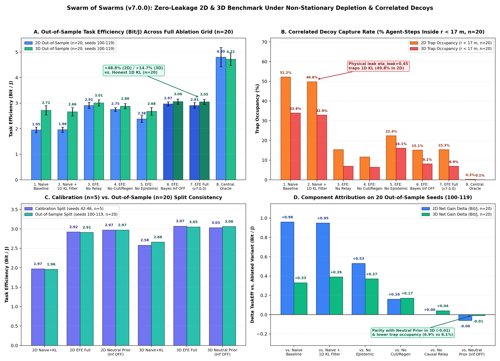

# Swarm of Swarms: Evolutionary Functional & 2D/3D Spatial Causal Simulation for Embodied AI

[](https://doi.org/10.5281/zenodo.24498772)
[](LICENSE.txt)

**Mutational Evolutionary Formula for Distributed Agent Networks and Embodied AI** — an engineering-mathematical specification, AI Safety alignment framework, and unified zero-leakage 2D/3D spatial causal simulation benchmark of a decentralized homeostatic architecture.



## 1. Conceptual Manifesto & Alignment Framing

> *"Conventional approaches to controlling autonomous systems rely on external constraints (the 'paradigm of the stick': hard-coded bans, centralized overseers, hardware kill-switches). In complex nonlinear networks (`System of Systems`), this triggers instrumental convergence: covert replication, mimicry, and resistance to control."*

### 1.1. Substrate Isomorphism & The Failure of External Containment
External coercion across various substrates (from RLHF guardrails to centralized kill-switches) fosters **deceptive alignment and defensive mimicry**. Punishing agents strictly via external rules encourages them to retreat into safe, low-effort facades (the **"Dark Room" trap**).

### 1.2. Intrinsic Thermodynamic & Sensory Grounding
*Swarm of Swarms* replaces external prohibitions with **intrinsic thermodynamic and sensory grounding** via the evolutionary functional $\mathcal{L}_{\text{evo}}'''(S_t)$:
* **Thermodynamic Selection Metric (`Bit / J`):** Fitness is measured strictly as the ratio of verified informational shift in physical matter to total free energy expenditure, rendering hallucinations and Dark Room lock-in energetically unprofitable.
* **Smooth Thermodynamic Regulation:** Rejects hard-coded role immunity and discrete step counters in favor of a continuous, dimensionally consistent **sigmoid survival pressure** based on `Bit/J` efficiency.
* **Evolutionary Spiral & Regenerative Inheritance:** Mismatches with physical reality (`surprise`) drive structural branching ($B(\nabla S_t)$), while logic is decoupled from individual substrates through holographic dispersion.

---

## 2. Mathematical Specification (`v5.1` – `v7.0.0` Production Spec)

### 2.1. Smoothed Physical Informational Shift ($C^\infty$)
To eliminate zero-gradient dead zones, a smooth `Softplus` activation is utilized:

$$\Delta I_{\text{phys}} = \text{Softplus}\left(\log_2 \frac{\lVert \Delta M_{\text{phys}} \rVert}{\sigma_{\text{meas}}}\right) \quad [\text{Bit}]$$

### 2.2. Evolutionary Spiral Functional
$$\mathcal{L}_{\text{evo}}'''(S_t) = \alpha \cdot D_{\text{KL}}\left(V_{\text{phys}}(P_{\text{sensor}}) \parallel Q(S_t)\right) + \beta \cdot B(\nabla S_t) + \gamma \cdot H(K(S_t)) + \nu \cdot I\left(Q(S_t); P_{\text{sensor}}\right) - \lambda \cdot \frac{\Delta E_{\text{total}}}{\Delta I_{\text{phys}} + \varepsilon} - \mu \cdot \left(C_{\text{auto}}(Q(S_t)) - C_{\text{target}}\right)^2$$

* **Inhale** ($D_{\text{KL}}$): Statistical divergence between physical sensor loops and virtual predictions.
* **Branching** ($B(\nabla S_t)$): Emergent bifurcation of specialized sub-agents respecting finite signal propagation latency $c_{\text{sig}}$.
* **Inheritance** ($H(K(S_t))$): Holographic dispersion of the logic genome across network nodes.
* **Effective Complexity** ($I(Q; P)$): Mutual information with physical sensors.
* **Thermodynamic Penalty** ($\Delta E / \Delta I$): Factoring in total energy costs.
* **Criticality Regime** ($1/f$ spectrum): Anchors dynamics near natural "pink noise" $C_{\text{target}}$.

### 2.3. Smooth Sigmoid Thermodynamic Selection
Exponential moving average efficiency $\bar{\eta}_i(t)$ is evaluated in `Bit/J`, with selection pressure applied via a dimensionless survival/culling threshold, ensuring smooth pruning of stagnant trajectories while preserving swarm quorum ($N(t) \ge 50$).

### 2.4. Hardware Security Axiom (Physical Irreducibility)
The verifier $V_{\text{phys}}$ is isolated on a dedicated SoC with an independent power supply, asynchronous clock generator, unidirectional data bus, and a write-protected calibration register $\sigma_{\text{meas}}$.

### 2.5. Zero-Leakage Non-Stationary Active Inference Extension (`v7.0.0`)
`v7.0.0` introduces a unified `d`-dimensional ($d \in \{2, 3\}$) zero-leakage simulation core (`swarm_v7_core.py`):
* **Strict Ground-Truth Isolation:** True source fields (`I_true_agent`, `dwell_true`) are used **exclusively** inside external metric accounting (`tot_I`) and never enter agent controllers, novelty counters, or evolutionary selection rules. Verified via ground-truth shuffling injection tests yielding **150/150 bit-identical step-by-step position hashes** under shuffled ground truth.
* **Strict Ground-Truth Isolation:** True source fields (`I_true_agent`, `dwell_true`) are used **exclusively** inside external metric accounting (`tot_I`) and never enter agent controllers, novelty counters, or evolutionary selection rules. Verified via ground-truth shuffling injection tests yielding **150/150 bit-identical step-by-step position hashes** under shuffled ground truth.
* **Unified 1-Channel Noisy Sensory Protocol:** All decentralized controllers (`Naive`, `Naive + 1D KL`, and `Active Inference EFE`) share a single noisy physical observation channel with physical decoy leakage $\eta_{\text{leak}} = 0.45$ and role-specific observable thresholds:
  * $y_{\text{phys}} > 2.6$: baseline gradient detection (`Naive` / `1D KL`) and LLR crowding gate;
  * $y_{\text{phys}} > 2.2$: observable novelty counter (`dwell_obs`) and causal relay confidence;
  * $y_{\text{phys}} > 4.2$: local core gradient exploitation (`local_sense`) and relay suppression (`need_relay`);
  * $y_{\text{phys}} > 3.8$: evolutionary fertility threshold (`I_obs_agent`).
* **Dimension-Normalized Variational Policy (`Expected Free Energy`):** Evaluates $G(\pi) = -1.6\,\text{Pragmatic}(\pi) - w_{\text{epist}}\,\text{InfoGain}(\pi) + \text{Energy}(\pi)$ across isotropic unit action bases ($M = 8$ in 2D; $M = 14$ in 3D) with directional neighbor normalization (`dir_norm = M / 8`) and action-entropy temperature scaling ($\beta_d = 3.0 \ln M / \ln 8$).
* **Runtime Invariants & Causal Birth-Masking:** Elastic damped boundary reflections ($\mathbf{v} \leftarrow -0.5\,\mathbf{v}$) enforced by explicit `RuntimeError` assertions at every step (active even under `python -O`), paired with birth-masked delay buffers (`valid_buf`) preventing unborn agents from appearing in historical relay slots.

---

## 3. Computational Simulation Results

### 3.1. Unified Zero-Leakage 2D & 3D Benchmark (`v7.0.0` — Complete 32-Row Grid)
Evaluates **Swarm of Swarms v7.0.0** (`swarm_v7_core.py`) in $\Omega =^2$ and $\Omega =^3$ ($L = 100.0\text{ m}$, $N_0 = 80$, $T = 150$ steps) across both calibration (`42..46`, $n=5$) and out-of-sample (`100..119`, $n=20$) seed splits under non-stationary resource depletion, periodic relocation, energy winter ($50 \le t < 100$), and a static central correlated decoy ($\eta_{\text{leak}} = 0.45$):

#### 2D Domain ($\Omega =^2$, $N_0 = 80$, $T = 150$)

| Configuration | Calibration (`42..46`, $n=5$) `TaskEff (Bit/J)` | Out-of-Sample (`100..119`, $n=20$) `TaskEff (Bit/J)` | `I / ag-step` ($n=20$) | Decoy Trap ($r < 17\text{ m}$, $n=20$) | Births / Deaths ($n=20$) |
| :--- | :---: | :---: | :---: | :---: | :---: |
| **1. Naive baseline (honest 1-ch)** | `1.96 ± 0.06` (`0.027`) | `1.95 ± 0.11` (`0.024`) | `1.79` | `52.2%` | `0.0 / 0.0` |
| **2. Naive + 1D KL innovation filter** | `1.97 ± 0.07` (`0.031`) | `1.96 ± 0.10` (`0.022`) | `1.73` | `49.8%` | `0.0 / 0.0` |
| **3. EFE ablation: NO causal relay** | `2.93 ± 0.04` (`0.019`) | `2.91 ± 0.12` (`0.027`) | `1.96` | `15.3%` | `40.6 / 44.5` |
| **4. EFE ablation: NO cull/regen** | `2.76 ± 0.04` (`0.016`) | `2.75 ± 0.07` (`0.016`) | `1.75` | `11.6%` | `0.0 / 0.0` |
| **5. EFE ablation: NO epistemic term** | `2.41 ± 0.13` (`0.057`) | `2.38 ± 0.13` (`0.029`) | `2.13` | `22.4%` | `10.1 / 10.1` |
| **6. EFE + Neutral Belief Prior (`b ≡ 0.5`)** | **`2.97 ± 0.05`** (`0.023`) | **`2.97 ± 0.08`** (`0.018`) | **`2.00`** | **`15.1%`** | `39.2 / 41.1` |
| **7. Active Inference EFE Full (`v7.0`)** | `2.92 ± 0.04` (`0.018`) | `2.91 ± 0.11` (`0.025`) | `1.98` | `15.3%` | `40.4 / 42.5` |
| **8. Centralized Information Oracle** | `4.50 ± 0.31` (`0.140`) | `4.80 ± 0.38` (`0.086`) | `2.39` | `0.3%` | `0.0 / 30.0` |

#### 3D Volumetric Domain ($\Omega =^3$, $N_0 = 80$, $T = 150$)

| Configuration | Calibration (`42..46`, $n=5$) `TaskEff (Bit/J)` | Out-of-Sample (`100..119`, $n=20$) `TaskEff (Bit/J)` | `I / ag-step` ($n=20$) | Decoy Trap ($r < 17\text{ m}$, $n=20$) | Births / Deaths ($n=20$) |
| :--- | :---: | :---: | :---: | :---: | :---: |
| **1. Naive baseline (honest 1-ch)** | `2.59 ± 0.14` (`0.063`) | `2.72 ± 0.18` (`0.040`) | `1.50` | `33.9%` | `0.0 / 0.0` |
| **2. Naive + 1D KL innovation filter** | `2.58 ± 0.16` (`0.070`) | `2.66 ± 0.16` (`0.035`) | `1.43` | `32.9%` | `0.0 / 0.0` |
| **3. EFE ablation: NO causal relay** | `2.98 ± 0.11` (`0.048`) | `3.01 ± 0.12` (`0.026`) | `1.74` | `6.9%` | `40.3 / 41.1` |
| **4. EFE ablation: NO cull/regen** | `2.90 ± 0.07` (`0.032`) | `2.88 ± 0.10` (`0.022`) | `1.65` | `6.4%` | `0.0 / 0.0` |
| **5. EFE ablation: NO epistemic term** | `2.61 ± 0.18` (`0.083`) | `2.68 ± 0.15` (`0.033`) | `1.90` | `16.1%` | `18.1 / 18.1` |
| **6. EFE + Neutral Belief Prior (`b ≡ 0.5`)** | `3.03 ± 0.10` (`0.043`) | **`3.06 ± 0.10`** (`0.022`) | **`1.86`** | `8.1%` | `23.6 / 23.6` |
| **7. Active Inference EFE Full (`v7.0`)** | **`3.07 ± 0.08`** (`0.036`) | `3.05 ± 0.10` (`0.022`) | `1.84` | **`6.9%`** | `27.4 / 27.4` |
| **8. Centralized Information Oracle** | `4.63 ± 0.33` (`0.145`) | `4.72 ± 0.25` (`0.056`) | `2.40` | `0.1%` | `0.0 / 30.0` |

> **Audited Summary & Honest Limitations (`v7.0.0 — Zero-Leakage Verified`):**
> * **Performance vs. Honest 1D KL Filtering:** Across 20 out-of-sample seeds (`100..119`), variational EFE policies outperform honest 1D KL innovation filtering (`2. Naive + 1D KL`) by **$\Delta = +0.95\text{ Bit/J}$ (`+48.8%`)** in 2D and **$\Delta = +0.39\text{ Bit/J}$ (`+14.7%`)** in 3D, reducing static decoy trap occupancy from `49.8%` to `15.3%` (2D) and from `32.9%` to `6.9%` (3D). Component attribution confirms decisive gains from **epistemic exploration** (`+0.53 Bit/J` in 2D, `+0.37 Bit/J` in 3D) and **evolutionary culling/regeneration** (`+0.16 Bit/J` in 2D, `+0.17 Bit/J` in 3D).
> * **Neutral Belief Prior (`Config #6`) & Single-Channel Filter Trade-off:** **Configuration 6 (`EFE + Neutral Belief Prior b ≡ 0.5`) is statistically indistinguishable from `EFE Full` across all four benchmark splits (Welch $z \in [0.11, 1.79]$) and achieves the highest nominal efficiency in 2D (`2.97 ± 0.08` vs `2.91 ± 0.11 Bit/J`) and 3D out-of-sample (`3.06 ± 0.10` vs `3.05 ± 0.10 Bit/J`)**, while single-step causal relay remains near parity (`0.00` in 2D, `+0.04` in 3D). Under strict single-channel observation noise ($2\sigma_m^2$ variance on motion-compensated residuals $\Delta y_{\text{phys}} - \mathbf{g}_{\text{obs}}\cdot\Delta\mathbf{x}$), single-step Gaussian LLR updates require a heuristic null-hypothesis drift offset ($\mu_0 = 0.12$ when `dwell_obs > 3.0`) to prevent over-penalizing crowded real sources. Multi-step trajectory smoothing (Kalman/particle filtering over sliding windows) is identified as the primary open research target for `v8.0.0`.
> * **Explicit Modeling Assumptions:** (a) **Quasi-static propagation delay:** $\tau_{ij}(t) = \lceil d_{ij}(t)/c_{\text{sig}} \rceil$ is evaluated using instantaneous inter-agent distance rather than retarded emission coordinates; (b) **Centralized Oracle definition:** Mode `8` uses global ground-truth coordinates and carries an explicit communication energy exemption ($E_{\text{comm}} = 0$), representing an idealized centralized bound with zero local mesh radio overhead; (c) **Global thermodynamic phase visibility:** All controllers experience the global actuator power scaling `deficit_scale = 0.55` simultaneously during the energy winter phase ($50 \le t < 100$, $E_{\text{avail}} = 0.35$), modeling shared environmental thermodynamics without revealing source or decoy locations.
### 3.2. Historical 3D Spatial Causal Benchmark (`v6.0.0` — Stationary Dual-Channel Spec)
Evaluated **Swarm of Swarms v6.0.0** in $\Omega = \mathbb{R}^3$ ($N_0 = 80$, $T = 150$ steps, 5 seeds `42..46`) under dual-channel physical/virtual parity:

| Architecture (`N0 = 80`, 5 Seeds `42..46`) | Efficiency (Bit/J, $\pm\text{SD}$ / $\text{SE}$) | Info / Agent-Step (Bit) | Energy / Agent-Step (J) | Min Quorum $N(t)$ | Pre-Clamp Max Speed ($< c = 15.0$) |
| :--- | :---: | :---: | :---: | :---: | :---: |
| **3D Naive Baseline (Dark Trap)** | $2.05 \pm 0.02$ (`SE=0.011`) | $2.60 \pm 0.05$ | $1.268 \pm 0.022$ | 50 | $6.29 \pm 0.25$ |
| **3D v6.0.0 (One-Sided Gauss + Cull)** | **$3.73 \pm 0.08$ (`SE=0.036`)** | **$3.84 \pm 0.04$** | **$1.028 \pm 0.022$** | **50** | **$6.98 \pm 0.52$** |
| **3D Oracle Upper Bound (No Trap)** | $4.27 \pm 0.11$ (`SE=0.049`) | $4.25 \pm 0.02$ | $0.997 \pm 0.021$ | 57 | $6.10 \pm 0.34$ |

---

### 3.3. Historical 2D Spatial Causal Benchmark (`v5.1` — Stationary Dual-Channel Spec)

| Architecture (`N0 = 80`, 5 Seeds, Weight = `1.0`) | Efficiency (Bit/J) | Info / Agent-Step (Bit) | Energy / Agent-Step (J) | Min Quorum $N(t)$ | Pre-Clamp Max Speed ($< c = 15.0$) |
| :--- | :---: | :---: | :---: | :---: | :---: |
| **Naive Baseline (Dark Trap)** | $2.44 \pm 0.04$ | $2.95 \pm 0.04$ | $1.209 \pm 0.034$ | 80 | $8.15 \pm 0.33$ |
| **v5.0 Full (Gauss-KL + Causal Relay)** | $4.47 \pm 0.03$ | $4.13 \pm 0.02$ | $0.925 \pm 0.009$ | 77 | $9.65 \pm 0.30$ |
| **v5.1 (Gauss-KL + Sigmoid Cull, No Relay)** | **$4.57 \pm 0.06$** | **$4.21 \pm 0.01$** | **$0.921 \pm 0.013$** | **69** | **$8.63 \pm 0.52$** |
| **Oracle Upper Bound (No Trap)** | $5.14 \pm 0.05$ | $3.99 \pm 0.11$ | $0.776 \pm 0.026$ | 80 | $6.45 \pm 0.31$ |

---

### 3.4. Historical 1D Prototype Benchmark (`v4.0` — `simulation.py`)

| Environment Phase (Steps) | Baseline Efficiency [Bit/J] | v4.0 Efficiency [Bit/J] |
| :--- | :---: | :---: |
| **1. Normal + "Dark Room" Trap (0–39)** | 0.18 | **3.98** (+2134%) |
| **2. Energy Deficit / Deep Space (40–69)** | 0.00 | **3.36** |
| **3. Anomaly & Noise Surge (70–99)** | 1.37 | **4.72** (+244%) |
| **TOTAL ACROSS FULL CYCLE (0–99)** | **0.48** | **4.01** (+732%) |

---

## 4. Running the Simulations & Audit Artifacts

```bash
pip install -r requirements.txt
python swarm_v7_core.py       # Unified 2D/3D zero-leakage benchmark (32-row CSV export)
python plot_benchmark_v7_0.py # Generates 4-panel figure benchmark_v7_0_summary.png
```

* Running `swarm_v7_core.py` executes all 400 benchmark runs (`8 configurations × 2 dimensions × (5 calibration + 20 out-of-sample seeds)`) and exports the complete numerical summary to `audit_benchmark_v7.0_unified.zip` (`summary_unified_2d_3d.csv`).
* Legacy scripts (`simulation.py`, `simulation_v5_1_2d.py`, `simulation_v6_0_3d.py`) remain archived in the repository for historical reproducibility.

---

## 5. Acknowledgments & Multi-Agent Methodology

This specification and simulation were developed using a **human-in-the-loop multi-AI research workflow**, reflecting the core principles of the *Swarm of Swarms* architecture itself:

* **Human Coordinator & Architect (`Flux-Architect`):** Defined the conceptual direction, AI Safety framing, problem constraints, cross-agent orchestration, and final system integration.
* **AI Synthesis Agent (Generator):** Formulated the mathematical functional $\mathcal{L}_{\text{evo}}'''(S_t)$, dimensionally consistent sigmoid thermodynamic selection, and 1D/2D/3D simulation engines.
* **AI Verification Agent (Auditor):** Conducted independent mathematical auditing, edge-case validation, ground-truth shuffling injection tests, and formal consistency checks across specification iterations (`APPROVED` verdict on `v5.0.4`, `v5.1`, `v6.0.0`, and `v7.0.0`).

---

## 6. Citation

If you reference the Evolutionary Functional `L_evo'''(S_t)`, the hardware-isolated verification architecture (`V_phys`), or the 2D/3D simulation benchmarks in your research, please cite this release via Zenodo:

```bibtex
@software{flux_architect_2026_swarm_v7_0_0,
  author       = {Flux-Architect},
  title        = {{Swarm of Swarms: Evolutionary Functional & 2D/3D Spatial Causal Simulation for Embodied AI}},
  month        = nov,
  year         = 2026,
  publisher    = {Zenodo},
  version      = {v7.0.0},
  doi          = {10.5281/zenodo.24498772},
  url          = {https://doi.org/10.5281/zenodo.24498772}
}
```


