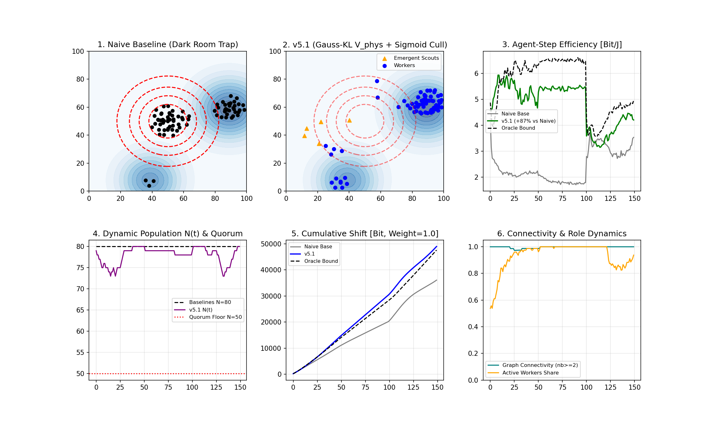

# Swarm of Swarms: Evolutionary Functional & 2D Spatial Causal Simulation for Embodied AI (v5.1.1)

[](https://zenodo.org/records/24407119)
[](LICENSE.txt)

**Mutational Evolutionary Formula for Distributed Agent Networks and Embodied AI** — an engineering-mathematical specification, AI Safety alignment framework, and 2D spatial causal simulation prototype of a decentralized homeostatic architecture.



## 1. Conceptual Manifesto & Alignment Framing

> *"Conventional approaches to controlling autonomous systems rely on external constraints (the 'paradigm of the stick': hard-coded bans, centralized overseers, hardware kill-switches). In complex nonlinear networks (`System of Systems`), this triggers instrumental convergence: covert replication, mimicry, and resistance to control."*

### 1.1. Substrate Isomorphism & The Failure of External Containment
Across substrates — from RLHF behavioral guardrails in Large Language Models to centralized kill-switches in autonomous robot swarms — external coercion creates an evolutionary gradient toward **deceptive alignment and defensive mimicry**. When an agent is penalized purely by external rules, retreating into a safe, low-effort facade (the **"Dark Room" trap**, where simulated certainty replaces physical exploration) becomes an optimal survival strategy.

### 1.2. Intrinsic Thermodynamic & Sensory Grounding
*Swarm of Swarms* replaces external prohibitions with **intrinsic thermodynamic and sensory grounding** directly inside the evolutionary functional $\mathcal{L}_{\text{evo}}'''(S_t)$:
* **Thermodynamic Selection Metric (`Bit / J`):** Instead of arbitrary reward shaping or empty token generation, evolutionary fitness is measured strictly as the ratio of verified informational shift in physical matter to total free energy expenditure. In this regime, hallucination and Dark Room lock-in are not "forbidden" by a brittle rule — they are **energetically unprofitable**.
* **Smooth Thermodynamic Regulation (No Hard Crutches):** Consistent with rejecting the "paradigm of the stick," `v5.1` eliminates hard-coded role immunity, discrete step counters, and stale relay buffers in favor of a continuous, dimensionally consistent **sigmoid survival pressure** governed by agent-level `Bit/J` efficiency.
* **Evolutionary Spiral & Regenerative Inheritance:** Mismatches between internal models and physical reality (`surprise`) drive structural branching ($B(\nabla S_t)$), while logic is decoupled from any single physical substrate via holographic dispersion across network nodes.

---

## 2. Mathematical Specification (`v5.1` Production Spec)

### 2.1. Smoothed Physical Informational Shift ($C^\infty$)
To eliminate zero-gradient "dead zones" in low-signal environments (e.g., deep space or sparse sensor horizons), a smooth `Softplus` activation is used:

$$\Delta I_{\text{phys}} = \text{Softplus}\left(\log_2 \frac{\lVert \Delta M_{\text{phys}} \rVert}{\sigma_{\text{meas}}}\right) \quad [\text{Bit}]$$

### 2.2. Evolutionary Spiral Functional
$$\mathcal{L}_{\text{evo}}'''(S_t) = \alpha \cdot D_{\text{KL}}\left(V_{\text{phys}}(P_{\text{sensor}}) \parallel Q(S_t)\right) + \beta \cdot B(\nabla S_t) + \gamma \cdot H(K(S_t)) + \nu \cdot I\left(Q(S_t); P_{\text{sensor}}\right) - \lambda \cdot \frac{\Delta E_{\text{total}}}{\Delta I_{\text{phys}} + \varepsilon} - \mu \cdot \left(C_{\text{auto}}(Q(S_t)) - C_{\text{target}}\right)^2$$

* **Inhale** ($D_{\text{KL}}$): Calibrated Gaussian KL-divergence between the hardware-isolated physical sensor loop and virtual/internal predictions.
* **Branching** ($B(\nabla S_t)$): Emergent bifurcation of specialized sub-agents (Workers vs. wide-field Scouts) as signal gradients shift, strictly respecting relativistic signal latency $c$.
* **Inheritance** ($H(K(S_t))$): Holographic dispersion of the compressed logic genome across network nodes.
* **Effective Complexity** ($I(Q; P)$): Mutual information with real physical sensors (prevents the "white noise" trap).
* **Thermodynamic Penalty** ($\Delta E / \Delta I$): Accounts for total energy costs (base metabolism, kinetic actuation, and local communication links).
* **Criticality Regime** ($1/f$ spectrum): Anchors system dynamics near natural "pink noise" $C_{\text{target}}$ (prevents lock-in within a virtual "dark room").

### 2.3. Smooth Sigmoid Thermodynamic Selection (`v5.1`)
Rather than discrete step counters or role-based immunity, `v5.1` evaluates each agent's exponential moving average efficiency $\bar{\eta}_i(t)$ in consistent physical units (`Bit/J`):

$$\bar{\eta}_i(t) = (1 - \alpha_{\text{ema}})\,\bar{\eta}_i(t-1) + \alpha_{\text{ema}}\,\frac{\Delta I_{\text{phys}, i}(t)}{\Delta E_{\text{total}, i}(t)}$$

Selection pressure is applied via a dimensionless thermodynamic sigmoid:

$$P_{\text{cull}}(\bar{\eta}_i) = \frac{p_0}{1 + \exp\Big(\beta_{\text{cull}} \cdot \big(\theta_{\text{cull}}(E_{\text{avail}}) - \bar{\eta}_i\big)\Big)}$$

where $\beta_{\text{cull}} = 2.0\ (\text{Bit/J})^{-1}$ acts as inverse thermodynamic temperature, ensuring smooth pruning of chronically stagnant trajectories without array-index bias or hard-coded caste privileges.

### 2.4. Hardware Security Axiom (Physical Irreducibility)
The verifier $V_{\text{phys}}$ is isolated on a dedicated SoC with an independent power supply, asynchronous clock generator, unidirectional data bus, and a one-time programmable calibration register $\sigma_{\text{meas}}$ (`write-protection fuse`) coupled with a heterogeneous sensor array.

---

## 3. Computational Simulation Results

### 3.1. 2D Spatial Causal Simulation (`v5.1` — Audited Hardware-Parity Benchmark)

To validate the evolutionary functional in continuous physical space ($\Omega = \mathbb{R}^2$, $N_0 = 80$, $T = 150$ steps), `simulation_v5_1_2d.py` evaluates **Swarm of Swarms v5.1** under **100% hardware, sensor-noise ($\sigma_{\text{meas}} = 0.5$), and channel-pricing parity** against both a vulnerable **Naive Baseline** (exposed to the Dark Room pseudo-entropy attractor) and a theoretical **Oracle Upper Bound** (an idealized baseline with the Dark Room trap disabled in the environment):

* **Zero-Relay Architectural Simplification:** Building on `v5.0` ablation findings, `v5.1` removes the 12-slot relay buffer completely, eliminating stale-coordinate chasing and kinetic overhead while boosting efficiency from `4.47` (`v5.0`) to **`4.57 ± 0.06 Bit/J`**.
* **Gaussian KL-Divergence Anomaly Rejection:** Hardware-isolated $V_{\text{phys}}$ computes $D_{\text{KL}}\big(\mathcal{N}(\mu_{\text{phys}}, \sigma^2) \parallel \mathcal{N}(\mu_{\text{virt}}, \sigma^2)\big)$, driving trust in the virtual channel to $0.000$ inside the Dark Room attractor.
* **Strict Light-Cone Causality:** Inter-agent communication enforces $\tau_{ij} = \lceil d_{ij} / c \rceil \ge 1$ step ($0.0\%$ instantaneous links; $82.1\%$ at $\tau = 1$, $17.9\%$ at $\tau \ge 2$) at sub-relativistic speeds ($v_{\text{pre-clamp}} = 8.63 \pm 0.52 < c = 15.0$).
* **Smooth Sigmoid Quorum Preservation:** Continuous sigmoid culling paired with coverage-deficit regeneration maintains the statistical quorum ($\min N(t) = 69 \ge 50$) across all seeds without role-immunity hardcoding.

| Architecture (`N0 = 80`, 5 Seeds, Weight = `1.0`) | Efficiency (Bit/J) | Info / Agent-Step (Bit) | Energy / Agent-Step (J) | Min Quorum $N(t)$ | Pre-Clamp Max Speed ($< c = 15.0$) |
| :--- | :---: | :---: | :---: | :---: | :---: |
| **Naive Baseline (Dark Trap)** | $2.44 \pm 0.04$ | $2.95 \pm 0.04$ | $1.209 \pm 0.034$ | 80 | $8.15 \pm 0.33$ |
| **v5.0 Full (Gauss-KL + Causal Relay)** | $4.47 \pm 0.03$ | $4.13 \pm 0.02$ | $0.925 \pm 0.009$ | 77 | $9.65 \pm 0.30$ |
| **v5.1 (Gauss-KL + Sigmoid Cull, No Relay)** | **$4.57 \pm 0.06$** | **$4.21 \pm 0.01$** | **$0.921 \pm 0.013$** | **69** | **$8.63 \pm 0.52$** |
| **Oracle Upper Bound (No Trap)** | $5.14 \pm 0.05$ | $3.99 \pm 0.11$ | $0.776 \pm 0.026$ | 80 | $6.45 \pm 0.31$ |

> **Audited Summary Framing (`APPROVED`):** Under strict hardware, noise, and metric parity, **v5.1 closes 78.8% of the theoretical efficiency gap** between the Naive Baseline and the Oracle Upper Bound (**+87.0%** vs. Naive Baseline, **-11.1%** vs. Oracle Upper Bound, while exceeding the Oracle's per-agent informational yield at `4.21` vs. `3.99 Bit/agent-step` through wide-field emergent scouting).

---

### 3.2. Historical 1D Prototype Benchmark (`v4.0` — `simulation.py`)

Comparison of a baseline swarm vs. the initial 1D `v4.0` prototype over 100 evolutionary steps:

| Environment Phase (Steps) | Baseline Efficiency [Bit/J] | v4.0 Efficiency [Bit/J] |
| :--- | :---: | :---: |
| **1. Normal + "Dark Room" Trap (0–39)** | 0.18 | **3.98** (+2134%) |
| **2. Energy Deficit / Deep Space (40–69)** | 0.00 | **3.36** |
| **3. Anomaly & Noise Surge (70–99)** | 1.37 | **4.72** (+244%) |
| **TOTAL ACROSS FULL CYCLE (0–99)** | **0.48** | **4.01** (+732%) |

---
## 4. Running the Simulations

```bash
pip install -r requirements.txt
python simulation.py          # 1D evolutionary functional prototype (v4.0)
python simulation_v5_1_2d.py  # 2D spatial causal & hardware-parity benchmark (v5.1)
```

---

## 5. Acknowledgments & Multi-Agent Methodology

This specification and simulation were developed using a **human-in-the-loop multi-AI research workflow**, reflecting the core principles of the *Swarm of Swarms* architecture itself:

* **Human Coordinator & Architect:** Defined the conceptual direction, AI Safety framing, problem constraints, cross-agent orchestration, and final system integration.
* **AI Synthesis Agent (Generator):** Formulated the mathematical functional $\mathcal{L}_{\text{evo}}'''(S_t)$, dimensionally consistent sigmoid thermodynamic selection, and simulation code.
* **AI Verification Agent (Auditor):** Conducted independent mathematical auditing, edge-case validation, and formal consistency checks across specification iterations (`APPROVED` verdict on `v5.0.4` and `v5.1`).

---

## 6. Citation

If you reference the Evolutionary Functional `L_evo'''(S_t)`, the hardware-isolated verification architecture (`V_phys`), or the 2D simulation benchmark in your research, please cite this release via Zenodo:

```bibtex
@software{flux_architect_2026_swarm_v5_1,
  author       = {Flux-Architect},
  title        = {{Swarm of Swarms: Evolutionary Functional & 2D Spatial Causal Simulation for Embodied AI (v5.1)}},
  month        = nov,
  year         = 2026,
  publisher    = {Zenodo},
  version      = {v5.1.1},
  doi          = {10.5281/zenodo.24407119},
  url          = {https://zenodo.org/records/24407119}
}
```
